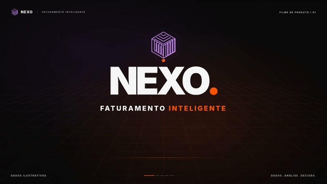
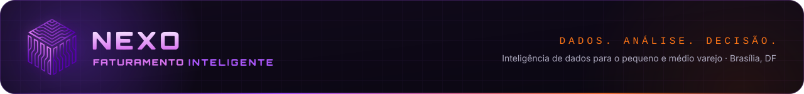

 

 

## 💡 Sobre o NEXO

O **NEXO** é uma plataforma B2B de **inteligência de dados e consultoria analítica automatizada** para o pequeno e médio varejo, com foco em **lojas de tintas, materiais de construção e reforma**.

Ele recebe os relatórios brutos exportados pelos sistemas de frente de caixa (PDVs), processa tudo em um pipeline automatizado em Python e entrega um **portal com gráficos claros e um parecer estratégico em linguagem simples e acionável**. A ideia é tirar a decisão do *feeling* e colocá-la nos dados.

> [!NOTE]
> O NEXO não concorre com ERPs nem com sistemas contábeis. Ele é a **camada de inteligência sobre os dados que o lojista já tem**, mas raramente consegue interpretar.

## 🎯 O problema × a resposta

<table>
  <thead>
    <tr>
      <th width="50%" align="left">😵 O gargalo do pequeno varejista</th>
      <th width="50%" align="left">✅ A resposta do NEXO</th>
    </tr>
  </thead>
  <tbody>
    <tr>
      <td><b>Dados opacos no PDV</b> Dezenas de tabelas pesadas em Excel/CSV que ninguém tem tempo de analisar.</td>
      <td><b>Importação sem esforço</b> Upload dos arquivos brutos, do jeito que o sistema de caixa exporta.</td>
    </tr>
    <tr>
      <td><b>Compras no <i>feeling</i></b> Reposição de memória: produtos encalhados e falta dos itens de alto giro.</td>
      <td><b>ETL automatizado</b> Limpeza e padronização imediatas com Pandas + NumPy.</td>
    </tr>
    <tr>
      <td><b>Capital de giro preso na prateleira</b> Dinheiro parado em mercadoria sem giro, sem nenhum alerta.</td>
      <td><b>Visualização descomplicada</b> Dashboards focados no que importa para a saúde financeira da loja.</td>
    </tr>
    <tr>
      <td><b>Sem visão de descasamento</b> O que foi comprado e o que foi faturado nunca aparecem lado a lado.</td>
      <td><b>Parecer estratégico prático</b> Pontos positivos, alertas e recomendações diretas para o gestor.</td>
    </tr>
  </tbody>
</table>

## ⚙️ Como funciona

## 📊 Indicador de Pressão de Estoque

Métrica exclusiva do NEXO que mede o **descasamento entre o que a loja comprou e o que faturou no mesmo período**. É um sinal estratégico para orientar compras e reposição, não um número contábil.

## 🧰 O que o NEXO entrega

<table>
  <tr>
    <td width="50%" valign="top">📈 <b>Indicador de Pressão de Estoque</b> Compras × faturamento do período, resumidos em um único sinal.</td>
    <td width="50%" valign="top">🧮 <b>Curva ABC (Pareto)</b> Os carros-chefe para negociar com fornecedores e os itens sem giro que prendem capital.</td>
  </tr>
  <tr>
    <td valign="top">🚦 <b>Semáforos executivos 5W2H</b> Verde, amarelo e vermelho: o que é oportunidade, o que pede atenção e o que é crítico.</td>
    <td valign="top">🧠 <b>Parecer estratégico em 5 etapas</b> Resumo executivo → pontos positivos → pontos de atenção → recomendações → próximos passos.</td>
  </tr>
  <tr>
    <td valign="top">📄 <b>PDF executivo</b> A análise publicada pronta para imprimir, enviar ou levar para a reunião.</td>
    <td valign="top">🤖 <b>NexoBot</b> Assistente de navegação em português, que roda 100% local, sem depender de IA externa.</td>
  </tr>
  <tr>
    <td valign="top">🔔 <b>Notificações em tempo real</b> Avisos via WebSocket quando há novidade, como uma análise recém-publicada.</td>
    <td valign="top">🏢 <b>Gestão multiempresa</b> A consultoria acompanha várias lojas, com fluxo rascunho → homologação → publicação.</td>
  </tr>
</table>

## 🎬 Veja o NEXO em ação

  
   
  Os valores e indicadores apresentados são ilustrativos.

## 💳 Planos

Todos os planos incluem indicadores e parecer estratégico. O que muda é a profundidade e a frequência da análise.

| | 🥉 **BRONZE** | 🥈 **PRATA** | 🥇 **OURO** |
| :--- | :---: | :---: | :---: |
| **Para quem** | Quer começar com clareza | Quer entender as mudanças | Quer acompanhar de perto |
| **Análises** | 1 por mês | 1 por mês | Até 2 por mês (recorte quinzenal) |
| **Indicadores** | Principais | Principais do período | Consolidados |
| **Parecer estratégico** | Objetivo | Completo: pontos positivos, alertas e recomendações | Aprofundado, com recomendações mais detalhadas |
| **Investimento** | Sob consulta | Sob consulta | Sob consulta |

## 🛠️ Stack & Engine

| Camada | Tecnologias |
| :--- | :--- |
| **Backend** |      |
| **Dados & ETL** |    |
| **Front-end** |     |
| **Banco & Infra** |      |
| **IA** |   |

## 🔐 Princípios que guiam o produto

- **Não é um sistema contábil.** O NEXO não calcula lucro, margem nem CMV: entrega sinais estratégicos para decidir melhor, não números fiscais.
- **Sucesso honesto ou recusa acionável.** Para qualquer arquivo, o motor de ETL extrai os indicadores reais ou explica exatamente o que faltou. Nunca uma análise calculada sobre dados inventados.
- **IA como apoio, não como dependência.** O parecer gerado por IA tem *fallback* determinístico local e passa pela revisão da equipe NEXO antes de chegar ao cliente.
- **LGPD desde a arquitetura.** Só indicadores agregados e o ranking da Curva ABC vão para o banco, nunca as transações linha a linha.
- **Segurança reforçada.** Proteção CSRF, *rate limiting*, sessão revalidada a cada requisição, WebSocket com origens restritas e CI de segurança a cada pull request.

## 📦 Repositórios

| Repositório | O que tem | Visibilidade |
| :--- | :--- | :---: |
| **Nexo-Faturamento-Inteligente** | Plataforma completa: portal SaaS em Flask (Admin × Cliente), motor de ETL, NexoBot, landing comercial e CI de segurança. | 🔒 Privado |
| [**nexofaturamentointeligente-coder**](https://github.com/nexofaturamentointeligente-coder/nexofaturamentointeligente-coder) | Este perfil: overview, identidade visual e assets da marca. | 🌐 Público |

## 🗺️ Roadmap

- [x] **Fase 1: Arquitetura & Engine Core**
  - Pipeline de ETL em Python/Pandas e lógica do Indicador de Pressão de Estoque.
  - Portal responsivo em tema escuro, com dashboards interativos.
  - Parecer estratégico com IA, exportação em PDF, NexoBot e notificações em tempo real.
- [ ] **Fase 2: Landing comercial & De-Para dinâmico**
  - Reestruturação comercial da landing page, orientada à conversão.
  - Interface de mapeamento dinâmico de colunas, para compatibilidade com qualquer PDV.
  - Integração com gateway de WhatsApp para alertas automáticos.
- [ ] **Fase 3: Tração regional em Brasília (DF)**
  - Programa de clientes piloto em 3 lojas de tintas locais.
  - Cases de sucesso e depoimentos em vídeo.
  - Apresentação para aceleradoras e programas de fomento (Cotidiano, FAP-DF, Centelha).

<!--
  Seções opcionais: descomente quando fizer sentido.

## 👥 Equipe

  <a href="https://github.com/USUARIO_SOCIO_1"> <b>Sócio / Lead Dev</b></a>
  &nbsp;&nbsp;&nbsp;&nbsp;
  <a href="https://github.com/USUARIO_SOCIO_2"> <b>Sócio / Co-Founder</b></a>

## 📈 Atividade

  

-->

## 📬 Vamos transformar o varejo juntos?

<!--
  Canais oficiais: descomente quando estiverem ativos.

-->

 

© 2026 NEXO — Faturamento Inteligente. Todos os direitos reservados.

